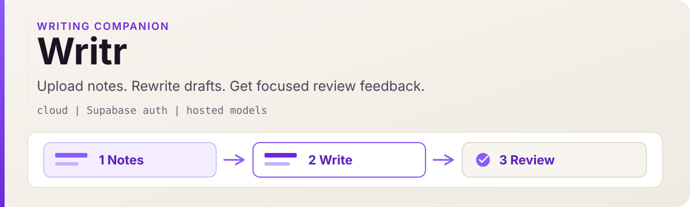

<p align="center">
  
</p>

# Writr

Writing companion for authors. Sign in with Supabase, keep lore in a notes library, rewrite drafts against that context, and get developmental review with scores and concrete suggestions.

The cloud app (`write/` + `write-backend/`) calls hosted Gemini, and those API keys stay on the server. The desktop app (`desktop/`) keeps chat and embeddings on this machine through Ollama.

[Getting started](#getting-started) · [What it does](#what-it-does) · [Agents](#agents) · [Packages](#packages) · [Configuration](#configuration)

## Getting started

**You need**

- [Node.js 20+](https://nodejs.org/) or [Bun](https://bun.sh/)
- [uv](https://docs.astral.sh/uv/) and Python 3.14+ for the cloud API
- A [Supabase](https://supabase.com/) project with [`docs/supabase-schema.sql`](docs/supabase-schema.sql) applied (enable **pgvector** first)
- A Gemini API key (`GEMINI_API_KEY`) for the cloud app
- [Ollama](https://ollama.com/) for the desktop app, with a tool-calling chat model and `nomic-embed-text`

### 1. Supabase

1. Create a project and enable **pgvector**.
2. Run [`docs/supabase-schema.sql`](docs/supabase-schema.sql) in the SQL editor.
3. Copy the project URL and publishable (anon) key.

### 2. Backend

```bash
cd write-backend
# add write-backend/.env — see Configuration
uv sync
uv run fastapi dev main.py
```

API: http://127.0.0.1:8000 · Docs: http://127.0.0.1:8000/docs · Health: http://127.0.0.1:8000/health

### 3. Web app

```bash
cd write
# add write/.env — see Configuration
bun install
bun run dev
```

Open the URL Vite prints (default http://localhost:5173), sign up, upload a note on Home, then try Write or Review.

> [!TIP]
> For UI-only work, set `VITE_USE_MOCK=true` in `write/.env`. Do not ship that flag.

### 4. Desktop

```bash
cd desktop
# add desktop/.env.local — see Configuration
bun install
bun run dev
```

Open http://localhost:3000. The Tauri window uses the same dev server:

```bash
cd desktop
bunx @tauri-apps/cli dev
```

That needs a Rust toolchain and the [Tauri prerequisites](https://tauri.app/start/prerequisites/). Ollama must already be running at `http://127.0.0.1:11434`.

## What it does

Two apps share a Supabase sign-in. They do not share inference.

**Cloud.** Notes, Write, and Review go through FastAPI. Live calls send `Authorization: Bearer <supabase access token>`. Chat and embeddings use Gemini.

**Desktop.** The WebView is a Next.js static export. Home, Library, and Settings are live. Write, Review, Analyse, Research, Plan, and Publish are in the shell. Agent turns run in a Node sidecar: the WebView does not spawn MCP processes or read skill files. Chat is a local `ChatOllama`. Embeddings use `nomic-embed-text` (768 dimensions).

Cloud screens:

| Screen | What you do |
| :--- | :--- |
| **Home** (`/dashboard`) | Upload reference notes (PDF, DOCX, TXT, MD), paste text, or fetch a link |
| **Write** (`/generate`) | Open a session draft (`.txt` / `.md` / `.docx`); revise it with your notes + style settings |
| **Review** (`/critique`) | Paste a scene / bible / character sheet; get scores and revision suggestions |
| **Settings** | Hosted model, Write/Review presets, sampling, system directive |

```text
Browser (write/) ──JWT──▶ FastAPI (write-backend/) ──▶ Supabase + hosted Gemini
Desktop WebView ──identity──▶ Supabase
Desktop sidecar ──▶ Ollama on 127.0.0.1:11434, local notes, optional MCP
```

## Agents

### Cloud

Write and Review are LangChain agents with a notes retrieval tool (RAG over your `reference_chunks`). The frontend builds the user message; the backend owns system prompts, tool loops, and model calls.

| Guard | Value |
| :--- | :--- |
| Rate limit | `10/minute` per IP on `/agents/write` and `/agents/critique` |
| Input cap | 80,000 characters (instruction + target) |
| Client timeout | 90s for agent calls (60s default for other APIs) |
| Vercel `maxDuration` | 120s on `main.py` |

Responses are normalized to plain text before they reach the UI (provider content blocks / signatures are stripped). Prod logs scrub secrets and avoid full manuscript content.

Streaming is planned later so long tool loops do not hit silent gateway timeouts.

### Desktop

Five agents share one `createAgent` harness in [`desktop/lib/agents`](desktop/lib/agents). `buildAgents` builds all five. Each gets its own `ChatOllama`: Write uses the creativity preset (Steady 0.2, Balanced 0.6, Inventive 1), and the other four stay at or below 0.4. The voice prompt stays the system prompt. The operating skill is a second system block, loaded from [`desktop/skills`](desktop/skills) plus the shared harness and story-document notes. There is no checkpointer in v1, and every turn uses a recursion limit of 12.

| Agent | Job | Tools |
| :--- | :--- | :--- |
| **Write** | Draft or revise in the document's own form | `search_project`, then Files, Git, and Notion when allowlisted |
| **Critique** | Scores and local fixes. The Analyse screen | `search_project`, then Files and Git when allowlisted |
| **Story Bible** | Propose canon from evidence. Accept stays with the author | `search_project`, then Notion when allowlisted |
| **Research** | One sourced answer | `search_project`, then Fetch, Wikipedia, Time, Notion, and browsers when allowlisted |
| **Revision Planner** | Ordered tasks from findings | Skill only. No library search and no MCP |

MCP plugins ship disabled. An empty allowlist attaches no tools. First-party `search_project` comes before MCP tools. A Notion page is evidence for the draft. It is not the story document, and it is not accepted canon. Call `close()` after the turn so the adapters drop. `failures` is the short list when a plugin does not connect.

## Packages

| Folder | Role |
| :--- | :--- |
| [`write/`](write/) | Cloud UI — React 19, Vite 8, TypeScript, Tailwind v4, shadcn/ui |
| [`write-backend/`](write-backend/) | FastAPI — auth, ingest, embeddings, agents, inference |
| [`desktop/`](desktop/) | Local app — Next.js 16 static export, Tauri 2, Ollama, five agents, MCP |

### Web scripts

```bash
cd write
bun run dev          # Vite
bun run build        # typecheck + production build
bun run typecheck    # tsc --noEmit
bun run lint         # ESLint
bun run format       # Prettier
```

### Backend surface

Protected routes expect a Supabase JWT. Check Swagger at `/docs` for the live API.

- **Upload ingest** — `POST /upload/{text,document,documents,link}` → 202 + queued job
- **Agents** — `POST /agents/write`, `POST /agents/critique`
- **Settings** — user Write/Review preferences persisted in Supabase

On long-lived hosts a worker claims jobs in-process; on Vercel that loop is off and Supabase Cron + `pg_net` hits `GET /internal/drain-jobs` instead (see `docs/supabase-drain-cron.sql`).

### Desktop scripts

```bash
cd desktop
bun run dev     # Next.js on http://localhost:3000
bun run build   # static export for the Tauri window
bun run lint
```

## Configuration

### Web — `write/.env`

```env
VITE_SUPABASE_URL=https://<project-ref>.supabase.co
VITE_SUPABASE_PUBLISHABLE_KEY=sb_publishable_<key>
VITE_API_URL=http://127.0.0.1:8000
```

| Variable | Required | Purpose |
| :--- | :--- | :--- |
| `VITE_SUPABASE_URL` | yes | Supabase project URL |
| `VITE_SUPABASE_PUBLISHABLE_KEY` | yes | Publishable / anon key (`VITE_SUPABASE_ANON_KEY` is a fallback) |
| `VITE_API_URL` | for live API | FastAPI origin, no path suffix |
| `VITE_USE_MOCK` | no | `true` = simulated uploads / rewrites |

### Backend — `write-backend/.env`

```env
ENVIRONMENT=development
PORT=8000

SUPABASE_URL=https://<project-ref>.supabase.co
SUPABASE_PUBLISHABLE_KEY=your-publishable-key
SUPABASE_SECRET_KEY=your-secret-key

# Required so Supabase Cron can drain background_jobs on Vercel
CRON_SECRET=generate-a-long-random-string

GEMINI_API_KEY=
# Optional overrides. Defaults: gemini-3.8-flash, gemini-embedding-2, 768.
# MODEL_NAME=gemini-3.8-flash
# GEMINI_EMBEDDING_MODEL=gemini-embedding-2
# EMBEDDING_DIM=768
```

Legacy `SUPABASE_ANON_KEY` / `SUPABASE_SERVICE_ROLE_KEY` still work. Chat and embeddings use `GEMINI_API_KEY`. The app starts without it; the first model call fails until it is set. Keep `EMBEDDING_DIM` (default `768`) aligned with the `pgvector` column.

### Desktop — `desktop/.env.local`

```env
NEXT_PUBLIC_SUPABASE_URL=https://<project-ref>.supabase.co
NEXT_PUBLIC_SUPABASE_PUBLISHABLE_KEY=sb_publishable_<key>
```

| Variable | Required | Purpose |
| :--- | :--- | :--- |
| `NEXT_PUBLIC_SUPABASE_URL` | yes | Supabase project URL. Sign-in only. Notes stay local. |
| `NEXT_PUBLIC_SUPABASE_PUBLISHABLE_KEY` | yes | Publishable / anon key (`NEXT_PUBLIC_SUPABASE_ANON_KEY` is a fallback) |

No model API key. Ollama ignores keys. Leave cloud models off to stay on `127.0.0.1:11434`.

### Background job drain (Supabase Cron)

Hobby Vercel only allows daily Vercel Cron, so Writr drains like Pantra:

1. Set `CRON_SECRET` on the Vercel API project (same value in production).
2. In the Writr Supabase SQL editor, store it in Vault:
   `select vault.create_secret('YOUR_CRON_SECRET', 'writr_cron_secret');`
3. Apply [`docs/supabase-drain-cron.sql`](docs/supabase-drain-cron.sql) — schedules `trigger-writr-drain-jobs` every minute via `pg_cron` → `pg_net` → `GET /internal/drain-jobs`.

If Deployment Protection blocks the call, use a production custom domain (recommended) or add a Vercel automation bypass header in the SQL function. A local `uvicorn` worker still works when you are developing offline.

> [!IMPORTANT]
> Tighten `allow_origins` in `write-backend/main.py` to your production frontend URL(s) before shipping.

## Repository layout

```text
writr/
├── assets/readme/             # README visuals
├── docs/supabase-schema.sql   # profiles, avatars, reference_chunks
├── write/                     # product UI
│   └── src/
│       ├── pages/             # auth, dashboard, write, review, settings
│       ├── api/               # Axios endpoints + limits
│       ├── components/
│       └── lib/               # prompts, file handler, supabase
├── write-backend/
│   ├── main.py
│   ├── ai/                    # agents, prompts, tools, model
│   ├── router/                # HTTP routes
│   ├── services/              # supabase, chunking, embeddings, queue
│   └── core/config.py
└── desktop/                   # local Next.js + Tauri app
    ├── app/                   # home, library, write, review, analyse, research, plan, publish, settings
    ├── lib/agents/            # shared createAgent harness, skills, prompts
    ├── lib/mcp/               # plugin catalog and sidecar host
    ├── skills/                # operating skills, beside the system prompts
    └── src-tauri/             # Tauri 2 shell
```

## Supabase

Schema source of truth: [`docs/supabase-schema.sql`](docs/supabase-schema.sql).

- **profiles** — `author_name`, `email`, `avatar_url` (signup trigger)
- **avatars** — public bucket, 5MB, JPEG/PNG/WebP, path prefixed by user id
- **reference_chunks** — note text + `embedding vector(768)` for retrieval

The web app reads `profiles` directly. Note ingest, embeddings, and agents go through the backend.

## Design

Tokens live in `write/src/index.css` (Tailwind v4 / shadcn, violet primary, IBM Plex Sans). Prefer semantic utilities (`bg-primary`, `text-muted-foreground`). Theme follows system preference; press `d` when not typing in a field to toggle.
