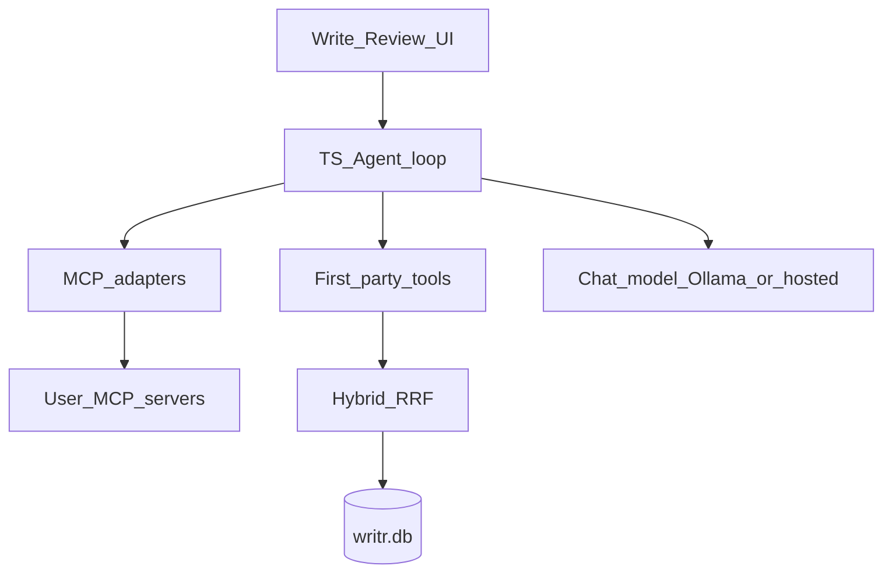

# Desktop agents, tools, and MCP — design

**Status:** proposed (not yet approved)  
**Date:** 2026-10-15  
**Depends on:** [`2026-10-15-desktop-local-rag-design.md`](./2026-10-15-desktop-local-rag-design.md)  
**Scope:** Writr desktop Write / Review agents, first-party tools, optional MCP host

Local notes never leave the machine in the RAG slice. Agents that need those notes must therefore run (or at least retrieve) on desktop. This doc proposes how agents, tools, and third-party MCP servers fit on top of local hybrid retrieve.

---

## Goals

- Port Write + Review agent loops to desktop so they can use **local** `search_notes` (hybrid RRF).
- Keep a small, explicit **first-party tool** surface the product owns.
- Optionally connect to **existing MCP servers** the author already runs, and expose their tools to the same agents.
- Preserve tenant safety: tools always close over `user_id` / project; never take owner id from the model.

## Non-goals (this slice)

- Replacing cloud FastAPI agents for the web app (`write/` + `write-backend/`)
- Exposing Writr itself as an MCP **server** to Cursor/Claude Desktop (later option)
- Story Bible / canon tools
- Multi-agent orchestration, long-running workflows, or durable checkpointers (v1 stays single-turn like cloud)
- Shipping a marketplace of MCP servers inside Writr

---

## Recommended decisions

| Topic | Recommendation | Why |
| :--- | :--- | :--- |
| Agent runtime | **TypeScript in the desktop WebView** (LangChain/LangGraph already in `desktop/package.json`) | Notes stay local; matches “no Rust business logic” |
| Parity | Same two agents: **Write** + **Review** | Matches cloud product; reuse prompt contracts where possible |
| Inference | Configurable: local Ollama chat model **or** hosted API key (author choice) | Embeddings already assume Ollama; chat can differ |
| First-party tools | Start with **`search_notes` only** | Same as cloud v1; avoid tool sprawl |
| MCP role | Writr is an optional **MCP host/client** | Author connects servers they already trust; agents call adapted tools |
| MCP default | **Off** until user adds a server + enables tools | Least surprise; notes stay private |
| Tool merge | First-party tools + allowlisted MCP tools → one tool list on the agent | Single create-agent path |
| Cloud backend | Unchanged for web | Desktop is a parallel path, not a rewrite |

**Open fork (needs your call):** chat model default — Ollama-only for fully offline, vs hosted Gemini/OpenAI with local RAG only. Recommendation: **Ollama chat default + optional hosted provider in Settings**.

---

## Architecture



### Layers

| Layer | Owns |
| :--- | :--- |
| **UI** | Write / Review screens, tool-call visibility, MCP server settings |
| **Agent** | System prompt, recursion limit, single-turn invoke, tool list assembly |
| **First-party tools** | `search_notes` → local `retrieve.ts` scoped by `user_id` |
| **MCP host** | Connect/disconnect servers, list tools, map MCP tools → LangChain tools |
| **Adapters** | Schema translate (JSON Schema ↔ Zod/tool args), errors, timeouts, name collision |

Cloud agents (`write-backend/ai/agents/*`) stay the web path. Desktop does **not** call `/agents/*` for note-backed turns unless we later add an explicit “upload context” mode (out of scope).

---

## Agents

Mirror cloud contracts:

- **Write** — revise / produce artifacts; must `search_notes` before inventing continuity.
- **Review** — scored feedback; must `search_notes` before claiming lore/voice mismatch.

### Runtime sketch (`desktop/lib/agents/`)

- `buildWriteAgent({ model, userId, tools, recursionLimit })`
- `buildReviewAgent({ model, userId, tools, recursionLimit })`
- Shared: assemble `tools = [...firstParty, ...mcpTools]`, apply system prompts (port TOON/text contracts from backend or share a package later).

V1: **no checkpointer**; recursion limit caps tool loops (same spirit as cloud `DEFAULT_RECURSION_LIMIT`).

### Model

- Embeddings: remain Ollama `nomic-embed-text` (RAG design).
- Chat: provider interface (`ollama` | `openai-compatible` | future); Settings picks default.
- If chat model unavailable → block agent UI with the same class of setup guidance as Ollama embed setup (not necessarily the same screen).

---

## First-party tools

### `search_notes` (required)

- Implementation: call desktop hybrid retrieve (vec + FTS → RRF).
- Args: `query: string` only (same as cloud).
- Closure: `userId`, optional `projectId`, `k` — **not** model-supplied.
- Return: concatenated chunk texts (or structured JSON if we improve citations later). Empty → `"No matching notes found."`

### Deferred first-party tools (not v1)

- `get_note` / open full note by id  
- Canon / Story Bible read-write  
- File open via dialog from the agent  

---

## MCP host and adapters

### Role

Writr **hosts** MCP connections so agents can use tools from servers the author already runs (filesystem, browser, calendar, custom lore servers, etc.). Writr is **not** required to speak MCP for core Write/Review — first-party `search_notes` works with MCP off.

### Config (sketch)

Stored locally (app data), not in Supabase:

```text
mcp_servers:
  - id, name, transport (stdio | sse | http),
    command/args/env OR url,
    enabled: bool,
    tool_allowlist: string[] | "*"   # default: empty until user picks tools
```

### Adapter behavior

1. On enable: connect, `list_tools`, show in Settings.
2. User allowlists which tools attach to Write / Review (default none).
3. Adapter wraps each allowed MCP tool as a LangChain/`DynamicStructuredTool`:
   - Prefix names to avoid collisions: `mcp_<serverId>_<toolName>`
   - Forward JSON args; map MCP errors to short author-facing strings
   - Timeouts + cancel on agent abort
4. On agent build: merge allowlisted MCP tools after first-party tools.

### Security / product rules

- MCP **off** by default.
- No auto-allow of all tools on a server.
- Stdio servers run as local subprocesses (Tauri-side spawn may be required if the WebView cannot); SSE/HTTP from the TS side when possible.
- Never put Supabase tokens or raw `writr.db` paths into MCP env unless the user explicitly configures that.
- Tool results may leave the machine if the **chat** provider is hosted — disclose that in Settings (same as pasting notes into a cloud model).

### Explicitly later

- Writr as MCP **server** exposing `search_notes` to Cursor  
- Bundled/curated MCP server list  
- Per-project MCP profiles  

---

## Package / module sketch

| Path | Role |
| :--- | :--- |
| `desktop/lib/agents/write.ts` | Build Write agent |
| `desktop/lib/agents/review.ts` | Build Review agent |
| `desktop/lib/agents/prompts.ts` | System prompts (ported/adapted) |
| `desktop/lib/tools/search-notes.ts` | First-party tool → `retrieve` |
| `desktop/lib/mcp/host.ts` | Connect, list, disconnect |
| `desktop/lib/mcp/adapter.ts` | MCP tool → LangChain tool |
| `desktop/lib/mcp/config.ts` | Load/save server config |
| UI Settings | MCP servers + tool allowlist |
| UI Write/Review | Invoke agent; show tool traces lightly |

**Deps (likely):** existing `langchain` / `@langchain/core` / `@langchain/langgraph`; official MCP TS SDK (`@modelcontextprotocol/sdk`) for client; Tauri command only if stdio subprocess must live in Rust.

**Not required for v1:** LangChain MCP toolkits that hide allowlisting; running agents in Rust.

---

## Sequencing

Depends on local RAG retrieve being real.

1. First-party `search_notes` tool + desktop Write agent (Ollama or one hosted provider)  
2. Review agent parity  
3. MCP host + adapter + Settings allowlist  
4. Polish: tool traces in UI, timeouts, name collisions, disconnect resilience  

Do **not** block RAG ingest/retrieve on this doc.

---

## Testing

- Unit: adapter maps MCP tool schema → invocable tool; allowlist filters correctly  
- Unit: `search_notes` closes over user id; never accepts owner from args  
- Fixture: agent with mock model calls `search_notes` then answers  
- Manual: one stdio MCP server (e.g. filesystem read-only) allowlisted; Write agent can call it; with MCP off, only `search_notes` appears  

---

## Relationship to cloud

| | Web (`write` + FastAPI) | Desktop |
| :--- | :--- | :--- |
| Notes | Supabase / pgvector | Local `writr.db` |
| Agents | Python LangChain | TS LangChain |
| Tools | `search_notes` | `search_notes` + optional MCP |
| MCP | None | Optional host |

Prompt text should stay aligned by hand until a shared package is worth it.

---

## Approval checklist

Confirm or revise before implementation:

- [ ] Agents run on desktop TS (not via cloud `/agents/*` for local notes)
- [ ] First-party v1 tool = `search_notes` only
- [ ] MCP = optional host/client with allowlist (not Writr-as-server)
- [ ] Chat model: Ollama default + optional hosted — or lock offline-only
- [ ] Cloud agents left as-is for web
