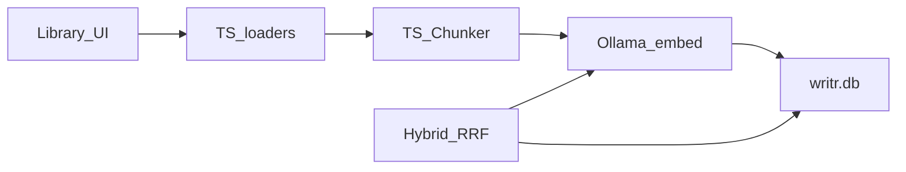

# Writr Desktop — final architecture

**Status:** approved synthesis  
**Date:** 2026-10-15  
**Product:** AuthorOS Desktop inside the Writr repo (`desktop/`)  
**Cloud app:** `write/` + `write-backend/` stay as they are; this doc does not replace them  

**Source decisions**

| Doc | Role |
| :--- | :--- |
| [desktop-local-rag-design.md](./2026-10-15-desktop-local-rag-design.md) | Evidence store + hybrid retrieve (approved) |
| [desktop-ui-ux-plan.md](./2026-10-15-desktop-ui-ux-plan.md) | Surfaces and desktop-vs-web UX |
| AuthorOS Desktop V2 PRD | Five agents, project memory, workspaces |
| Brainstorm (2026-10-15) | Research layering, local-first I/O, MCP hybrid, phased agents |

This file is the **single architecture map**. Detail for RAG schema/modules remains in the RAG design; screen layouts remain in the UI/UX plan.

---

## 1. Problem and solution

Authors lose track of what the story already established. Cloud Writr can search notes and run one-shot Write/Review, but nothing local records canon, open threads, or turns review into ordered revision work.

**Desktop solution:** a local project workspace. Notes are searchable **evidence**. A story bible holds **accepted** facts. A harness routes the author’s request, assembles small context, runs the right agents, validates, then shows results. The manuscript stays the draft until the author accepts alternatives.

---

## 2. Locked decisions

| Topic | Decision |
| :--- | :--- |
| Runtime | TS in Next/Tauri WebView for pipeline + agents; thin Tauri for dialogs, opener, paths, SQLite |
| Evidence store | One `writr.db`: notes, chunks, FTS5, **sqlite-vec** (not usearch/LanceDB) |
| Embeddings | Ollama `nomic-embed-text` (768-d) |
| Retrieval | Vector top-k + FTS5 top-k → **RRF** |
| Sources (notes) | DOCX, TXT, MD, paste, links — **no PDF** |
| Notes vs canon | Notes = evidence; canon only via Story Bible + author accept (or author edit) |
| Source of truth | **Local first:** `writr.db` + project folder; Notion is sync edge |
| Research web | **Layered:** HTTP + Readability first → escalate to **app-owned** browser; not the author’s personal Chrome |
| Folders | **First-party** Tauri FS, sandboxed to project root |
| Notion | **MCP** adapter: import → proposals/notes; write/update linked Notion docs from local |
| Agent rollout | **Phased:** core agents + local tools → folders → Notion MCP |
| Models | Setting: hosted and/or OpenAI / Anthropic / OpenRouter / Ollama / LM Studio; contracts unchanged |
| Cloud FastAPI | Not used for desktop notes |
| Graph DB | Optional later; v1 stores links beside records in SQLite |

---

## 3. System context

```text
┌──────────────────────────── desktop/ ────────────────────────────┐
│  UI (setup → library → later AuthorOS shell)                     │
│       │                                                          │
│       ▼                                                          │
│  Harness: router → context assembly → agents → validation        │
│       │              │                                           │
│       │              ├─ Tool registry                            │
│       │              │     first-party: search, canon, folders…  │
│       │              │     MCP (later): Notion                   │
│       │              ▼                                           │
│       │         Project memory (SQLite structured)               │
│       │         Evidence RAG (same writr.db: FTS + vec)          │
│       ▼                                                          │
│  Ollama / hosted LLM (embed + chat per settings)                 │
│  Tauri: dialogs, opener, path, rusqlite + sqlite-vec             │
└──────────────────────────────────────────────────────────────────┘

Supabase = sign-in identity (user_id) only for local rows.
write-backend = cloud product path; not desktop note ingest.
```

---

## 4. Layered architecture

```text
┌─ UI / UX ─────────────────────────────────────────────────────────┐
│  Phase 1: Setup gate + Library                                    │
│  Phase 2: AuthorOS shell (Home, Write, Plan, Analyse, Research,   │
│           Publish) + story sidebar + palette + docks              │
│  Phase 3: Folder badge, Notion link status                        │
└───────────────────────────────────────────────────────────────────┘
         │
┌─ Harness engineering ─────────────────────────────────────────────┐
│  Fixed order: detect intent → assemble context → run agent(s)     │
│  → (mixed: later agent reads earlier output) → validate → compose │
│  Limits, tool allowlists, retries, tracing                        │
└───────────────────────────────────────────────────────────────────┘
         │
┌─ Context engineering ──────────────┐  ┌─ Agent memory ────────────┐
│  Mode-scoped slices only           │  │  Long-term: canon, cards, │
│  Named entities/chapters from      │  │  events, threads, graph   │
│  request → cards/threads/canon     │  │  Evidence: notes/chunks   │
│  + hybrid retrieve hits            │  │  Ephemeral: turn scratch, │
│  Never whole-project dump          │  │  mixed-agent handoff      │
└────────────────────────────────────┘  └───────────────────────────┘
         │
┌─ Agents (five only) ──────────────────────────────────────────────┐
│  Write · Critique · Story Bible · Research · Revision Planner     │
│  Extra capability = tools, not new agents                         │
└───────────────────────────────────────────────────────────────────┘
         │
┌─ Eval & error analysis (offline + CI) ────────────────────────────┐
│  Fixtures → contract scores → failure taxonomy → fix → re-eval    │
└───────────────────────────────────────────────────────────────────┘
```

| Concern | Owns |
| :--- | :--- |
| **Harness** | Router, tool registry, recursion limits, mixed-mode chain, validation gate |
| **Context engineering** | What enters the prompt this turn |
| **Agent memory** | What persists (structured + RAG); Notion/folders are I/O, not memory core |
| **Eval** | Router modes, write-canon rules, finding/task/source validity, retrieve/RRF |
| **Error analysis** | Traces + eval fails → prompt/tool/harness change + new fixture |

---

## 5. Local RAG (evidence substrate)

Full detail: [local RAG design](./2026-10-15-desktop-local-rag-design.md).



- **Engine:** sqlite-vec inside SQLite (same file as notes/FTS).  
- **Ingest:** in-process async + UI progress; `status = ready | failed`; no job queue.  
- **Dedupe:** `(user_id, project_id, content_sha256)`.  
- **TS modules:** `document-loader`, `chunker`, `ollama`, `ingest`, `retrieve`, `rrf`.  
- **Tauri:** migrations, note/chunk CRUD, `search_fts`, `search_vec`.  
- **First-run:** ping Ollama → pull embed model → migrate DB → unlock library.

Agents call the same hybrid retrieve as `search_project` (first-party tool). Notes never become canon without Story Bible + accept.

---

## 6. Agents and tools

### 6.1 Router modes

`write` · `analyse` · `canon` · `research` · `revision` · `mixed`  

Author does **not** pick an agent. Palette commands map to modes. Ambiguous → classification + low confidence.

### 6.2 Agent contracts (summary)

| Agent | Reads | Writes | Invalid if |
| :--- | :--- | :--- | :--- |
| **Write** | Prompt, assembled context, outline, character cards | Draft text, labeled alternatives (off-manuscript until accept), suggestions | — |
| **Critique** | Manuscript slice + context | Findings (issue, evidence, severity, fix) | Finding lacks evidence or severity |
| **Story Bible** | Evidence + draft slices | Canon, cards, events, threads, graph links (or **proposals**) | — |
| **Research** | Query + tools | Research notes with **source** | Note without source |
| **Revision Planner** | Findings, continuity, goals | Tasks (priority, deps, effort) linked to findings | Task with no finding |

Only Story Bible (and the author UI) may **accept** canon. Other agents may **propose**.

**Instruction vs canon:** if this turn’s instruction conflicts with an accepted fact, follow the instruction, **report** the conflict, leave stored fact unchanged.

### 6.3 Tool ownership

| Tool | Slice | Source | Agents |
| :--- | :--- | :--- | :--- |
| `search_project` (hybrid RRF) | A | first-party | all (read) |
| `get_canon` / `propose_canon` / accept via UI | A | first-party | bible write; others propose |
| Threads / revision board ops | A | first-party | bible / planner |
| Layered `research_fetch` / search | A | first-party (HTTP; app browser escalate) | Research |
| `fs_list` / `fs_read` / `fs_write` (project root only) | B | first-party Tauri | Research, Write (load/save) |
| Notion read/write/update | C | MCP | Research (+ export of accepted local docs) |

**Never via MCP:** canon accept, plot-thread status as sole authority, revision board, story health, sandbox branches, hybrid retrieve over `writr.db`.

### 6.4 Research layering (use-my-browser philosophy)

1. Define success (fact + citation).  
2. Cheap layer: HTTP fetch + Readability (same spirit as note link ingest).  
3. Escalate to **app-owned** browser only if JS shell / thin extract.  
4. Store note with source URL; thin extract fails.  
5. Do not automate the author’s personal Chrome profile for product Research.

### 6.5 Agent delivery slices

| Slice | Ship |
| :--- | :--- |
| **A** | Router + five agents + validation + local tools only (search, canon propose/accept, threads, revision tasks) + layered Research web |
| **B** | Project-scoped folder tools |
| **C** | MCP host + Notion import/update |

Do not ship Notion before accept/propose rules exist.

---

## 7. Project memory (structured)

Stored locally (SQLite tables beside notes; exact DDL at implementation):

- **Canon fact** — source, entity, value, confidence, chapter; proposal vs accepted  
- **Character** — name, aliases, goals, fears, traits, relationships, voice  
- **Event** — title, sequence/date, participants, consequences, dependencies  
- **Plot thread** — intro, references, resolution; status: open | referenced | pending resolution | resolved | archived  
- **Research note** — source, summary, citation  
- **Graph links** — character↔character, character↔event, character↔place, place↔event, faction↔character, event↔thread  

Performance targets (single project, author machine): local search &lt; 100 ms; bible update from a passage &lt; 3 s; continuity pass &lt; 10 s; character graph load &lt; 1 s.

---

## 8. UI/UX architecture

Full screens: [UI/UX plan](./2026-10-15-desktop-ui-ux-plan.md).

### Stance

Desktop = local workspace, not a thicker web Dashboard. Native file dialogs, local progress, Ollama honesty, evidence ≠ canon.

### Phases

| Phase | Chrome |
| :--- | :--- |
| **0** | Auth (exists) |
| **1** | Setup gate → Library (list + add + search) |
| **2** | AuthorOS shell + sidebar; Library folds into Research/Notes; Write dock; Analyse; palette |
| **3** | Folder affordances; Notion link status on notes |

### Phase 1 library (implementation target)

```text
Setup (Ollama → model → DB)
  → Library: notes list | detail / hybrid search
       Add: File (Tauri) | Paste | Link
       Progress: Reading → Chunking → Embedding → Saving
       Failed → Retry
```

No Write/Critique clone until Slice A agents exist.

### Phase 2 surfaces

Home · Write · Plan · Analyse · Research · Publish — Plan has **no** agent; Revision mode output lands on revision board; canon queries → canon explorer.

Harness/validation errors show as **structured dock messages**, not a chat transcript as the main UX.

---

## 9. Data flow (end-to-end)

### Ingest (Phase 1)

```text
UI Add → loader → sha/dedupe → note row → chunk → Ollama embed
  → chunks + vec + FTS → status ready|failed → list refresh
```

### Retrieve

```text
Query → embed → search_vec + search_fts → RRF → UI hits
       └──────── also used by search_project tool ────────┘
```

### Agent turn (Slice A+)

```text
Request/palette → router → context assembly (canon slices + search_project)
  → agent tool loop → validation → UI (draft | findings | proposals | tasks)
```

### Mixed mode example

```text
Critique findings → (optional bible checks) → Revision Planner tasks
  chain preserved: finding → evidence → task
```

### Notion (Slice C)

```text
Import: Notion MCP → research note / proposed cards (source = Notion URL)
Export/update: accepted local doc → Notion MCP write (author-linked page)
Local DB remains canonical
```

---

## 10. Packages and boundaries

| Area | Use | Avoid (desktop v1) |
| :--- | :--- | :--- |
| Loaders | mammoth, Readability + linkedom | pdf.js, LangChain loaders |
| Vectors | rusqlite + sqlite-vec | LanceDB, usearch, tauri-plugin-sql for vec |
| Agents | TS/LangGraph-style (align with desktop deps) | New specialist agents beyond the five |
| Research browser | App-owned escalate | Author Chrome DevTools as product path |
| External lore | Notion MCP | Notion as system of record |
| Cloud | Supabase auth only | FastAPI note ingest for desktop |

---

## 11. Testing strategy

| Layer | Cases |
| :--- | :--- |
| RAG | Loader fixtures (incl. PDF reject), chunker, RRF, dedupe; Ollama smoke |
| Router | One fixture per mode + mixed; ambiguous → low confidence |
| Memory contracts | Only bible/author write accepted canon; proposals stay proposals |
| Critique / revision / research | Evidence+severity; task↔finding; source required |
| Validation | Contradictory prose fails unless turn instruction overrides |
| Context assembly | One-character question does not require whole manuscript |
| Story health | Score tracks open findings; drill-down lists them |
| UI | Thread status, revision columns, palette → router, sandbox ≠ main draft |
| Eval loop | Failures classified → fixture added before prompt churn |

Write/Review cloud evals remain precedent for Write/Critique starter cases.

---

## 12. Implementation roadmap

| Order | Deliverable | Depends on |
| :--- | :--- | :--- |
| 1 | Tauri DB + TS ingest/retrieve + setup/library UI | RAG + UI Phase 1 |
| 2 | Fixture tests + Ollama smoke | (1) |
| 3 | Project memory schema + propose/accept UI | AuthorOS Slice A |
| 4 | Router + five agents + validation + `search_project` | (1)+(3) |
| 5 | AuthorOS shell (Phase 2 UX) wired to harness | (4) |
| 6 | Folder tools (Slice B) | (4) |
| 7 | MCP host + Notion (Slice C) | (4)+accept rules |
| 8 | Eval suite expansion + error-analysis tracing | ongoing from (4) |

**Tonight / next coding session:** steps **1–2** only (local RAG + library UX). Do not start agents or Notion in the same night.

**Task checklist:** [2026-10-15-desktop-implementation-tasks.md](./2026-10-15-desktop-implementation-tasks.md)

---

## 13. Out of scope (whole desktop architecture)

- Reader persona simulations; what-if plotline simulation  
- Shared canon across books / series bible spanning projects  
- Replacing cloud Writr  
- Chat transcript as the primary workspace  
- Agents beyond the five; author-facing “pick an agent”  
- Streaming as a requirement of this architecture (separate concern)  
- Dedicated graph server for first release  
- PDF on desktop notes  
- Cloud sync of notes/embeddings (undecided later; local is working copy)

---

## 14. Open questions (carry from PRD)

- After a turn overrides a fact, when (if ever) does a later action update stored canon?  
- Exact story-health formulas beyond rollup of open findings  
- Sandbox branch → replace main manuscript? Branch count limits?  
- Continuity-error “90% drop” baseline measurement  
- Whether project metadata syncs to the Supabase account  

---

## 15. Success criteria

**Phase 1:** setup without tribal knowledge; add `.md`/`.docx`; hybrid search returns chunks; failures show Retry; UI never claims cloud sync or canon.

**Slice A:** router classifies; Write/Critique/Bible/Research/Planner obey write rules; validation blocks silent canon breaks; context stays small.

**Slice B/C:** folder I/O stays inside project root; Notion updates never bypass accept.

**Product:** notes remain evidence; accepted bible is the continuity contract; desktop feels like a local author OS, not a port of the web dashboard.
