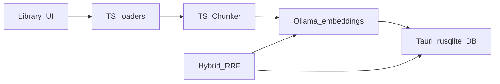

# Desktop local RAG — design

**Status:** approved  
**Date:** 2026-10-15  
**Scope:** Writr desktop (`desktop/`) local-only note ingest and retrieval  
**Parent:** [2026-10-15-desktop-architecture.md](./2026-10-15-desktop-architecture.md) (final synthesis)

Writers sign in with Supabase; notes, chunks, and embeddings stay on disk in one SQLite database. Load → chunk → embed → store runs in TypeScript inside the Next/Tauri WebView. Tauri stays thin: file dialogs, opener, app-data path, and a small `rusqlite` + `sqlite-vec` command module.

---

## Goals

- Let authors add searchable evidence (notes) from DOCX, TXT, MD, paste, and links — without sending note bodies to the cloud.
- Hybrid retrieval from day one (vector + FTS5 → RRF) so keyword and semantic hits both surface.
- Keep business logic in TypeScript; avoid a Rust-heavy pipeline the author does not maintain.
- Clear first-run path when Ollama is missing or the embed model is not pulled.

## Non-goals (this slice)

- Story Bible / canon auto-promotion
- Write / Critique agents wiring to local RAG
- PDF support
- Cloud sync of notes or embeddings
- Hosted / cloud embeddings
- Cloud-style ingest job queue (`ingest_jobs` table)

---

## Approved decisions

| Topic | Decision |
| :--- | :--- |
| Runtime | TypeScript in the WebView for load → chunk → Ollama embed → retrieve |
| Tauri role | Dialogs, opener, app-data path, SQLite (`rusqlite` + `sqlite-vec`) only |
| Storage | Single `writr.db` in app data: notes + chunks + FTS5 + sqlite-vec |
| Why custom DB module | Stock `tauri-plugin-sql` cannot load sqlite-vec reliably |
| Retrieval | Vector top-k + FTS5 top-k → Reciprocal Rank Fusion (RRF) |
| Embeddings | Local Ollama; default model `nomic-embed-text` |
| Sources | DOCX, TXT, MD, paste, links — **no PDF** |
| Ingest model | In-process async with UI progress; note `status` = `ready \| failed` |
| Auth | Supabase sign-in only; rows scoped by `user_id` (+ nullable `project_id`) |
| Product rule | Notes are searchable evidence, not auto-canon; link notes require a source URL |

---

## Architecture

### Responsibility split

| Layer | Owns |
| :--- | :--- |
| **TS (`desktop/lib/…`)** | Document loaders, chunker, Ollama HTTP client, ingest orchestrator, hybrid retrieve + RRF, author-facing error messages |
| **Tauri (`desktop/src-tauri/`)** | Open/create `writr.db`, migrations, insert/update notes & chunks, FTS5 query, sqlite-vec insert/query, app-data path, file dialog, opener |
| **UI** | First-run Ollama setup, library list, ingest progress, Retry on failed notes, retrieve smoke / search |

Cloud FastAPI (`write-backend/`) is **not** used for desktop notes in this slice. Existing backend loaders (including PDF) remain the cloud path only.

---

## Data model

Database file: `{appDataDir}/writr.db` (exact Tauri path API TBD at implementation; one DB per install).

### `notes`

| Column | Type | Notes |
| :--- | :--- | :--- |
| `id` | TEXT PK | UUID |
| `user_id` | TEXT NOT NULL | Supabase user id |
| `project_id` | TEXT NULL | Reserved for AuthorOS; nullable in v1 |
| `title` | TEXT NOT NULL | Display title |
| `source_type` | TEXT NOT NULL | `file` \| `paste` \| `link` |
| `source_uri` | TEXT NULL | File path, or required URL for `link` |
| `content_sha256` | TEXT NOT NULL | Hex digest of normalized raw text |
| `raw_text` | TEXT NOT NULL | Full extracted body |
| `status` | TEXT NOT NULL | `ready` \| `failed` (ingest outcome) |
| `error_message` | TEXT NULL | Author-facing message when `failed` |
| `created_at` | TEXT NOT NULL | ISO-8601 UTC |

**Dedupe:** Unique on `(user_id, COALESCE(project_id, ''), content_sha256)`. Same content for the same user/project → skip re-embed; surface a clear “already in library” message.

### `chunks`

| Column | Type | Notes |
| :--- | :--- | :--- |
| `id` | TEXT PK | UUID |
| `note_id` | TEXT NOT NULL | FK → `notes.id` ON DELETE CASCADE |
| `ordinal` | INTEGER NOT NULL | 0-based order within note |
| `content` | TEXT NOT NULL | Chunk text |
| `metadata_json` | TEXT NOT NULL | JSON object (source hints, offsets, etc.) |

### FTS5

Virtual table over chunk `content` (and optionally title via external content or a joined query). Used for keyword top-k.

### Embeddings (sqlite-vec)

Virtual / vec table keyed by chunk id (or rowid mapping), storing float vectors with:

- `model_id` — e.g. `nomic-embed-text`
- Fixed dims for that model (nomic-embed-text: **768**)

Re-embed required if `model_id` / dims change; v1 does not migrate vectors across models.

### Status lifecycle

1. Insert note with extracted text (or fail load before insert).
2. Chunk + embed in-process; UI shows progress.
3. On success → `status = ready`.
4. On failure → `status = failed`, set `error_message`; UI offers **Retry** (re-run chunk/embed from stored `raw_text` when load already succeeded).

There is no durable job queue table.

---

## TypeScript modules

Suggested layout under `desktop/lib/` (names may adjust slightly at implementation):

| Module | Role |
| :--- | :--- |
| `document-loader.ts` | Route by source: DOCX (`mammoth`), TXT/MD (utf-8 text), paste (passthrough), link (fetch HTML → Readability + linkedom or equivalent) |
| `chunker.ts` | Custom chunker over plain text + metadata; no LangChain-heavy loaders for v1 |
| `ollama.ts` | `fetch` to local Ollama: ping, list/pull model with progress, embed batch |
| `ingest.ts` | Orchestrate load → hash → dedupe check → persist note → chunk → embed → persist chunks/vecs; update status |
| `retrieve.ts` | Embed query → vec top-k + FTS top-k → RRF merge → ranked chunks |
| `rrf.ts` | Reciprocal Rank Fusion helper |

### Loaders — rules

- **Supported extensions:** `.docx`, `.txt`, `.md` (and paste / link without extension).
- **PDF / unknown:** Reject with a clear unsupported-type message (do not silently strip).
- **Empty extract:** Fail with empty-content message.
- **Links:** `source_uri` required; reject “thin” extracts below a minimum character threshold (align with backend spirit; suggested floor ~200 chars of article text after Readability).
- **Output:** `{ text, metadata }` ready for the chunker (filename, mime/source_type, uri).

### Chunker

- Operate on plain text only.
- Stable ordinals; metadata may include character offsets and source filename.
- Sizing constants chosen at implementation (overlap + max chars/tokens); keep tunable in one place.

### Ollama client

- Default base URL: `http://127.0.0.1:11434` (override via env/config if needed later).
- Embed model: `nomic-embed-text`.
- Operations: health/ping, ensure model (pull with progress events for UI), embed strings.

### Ingest orchestrator

1. Load → text + metadata.
2. SHA-256 of normalized text; if duplicate for user/project → stop with duplicate message (no re-embed).
3. Persist note (`status` in progress or pending until embeds finish — implementation may use `failed` only on error and treat missing chunks as incomplete, or a transient UI-only state; **persisted** terminal values remain `ready` \| `failed`).
4. Chunk → embed each chunk → write chunks + vectors via Tauri commands.
5. Mark `ready` or `failed`.

### Retrieve (hybrid RRF)

1. Embed the query with the same `model_id`.
2. Vector search: top-k by distance/similarity (k configurable, e.g. 20).
3. FTS5 search: top-k by BM25/rank (same k or separate).
4. Merge with RRF: score `Σ 1 / (rrf_k + rank_i)` across lists (standard `rrf_k = 60` unless tuned).
5. Return deduped chunk hits with note ids, ordinals, and scores for UI / later agents.

---

## Tauri DB module

Custom commands over `rusqlite` + `sqlite-vec` extension load (not `tauri-plugin-sql` for vec).

### Expected commands (sketch)

- `db_migrate` / open-on-startup — create schema + FTS + vec tables
- `note_insert` / `note_update_status` / `note_list` / `note_get`
- `note_find_by_sha` — dedupe lookup
- `chunks_replace_for_note` — delete+insert chunks for a note (Retry path)
- `embeddings_upsert` — write vec rows for chunk ids
- `search_fts` — keyword top-k
- `search_vec` — embedding top-k
- Path helpers: app data dir for `writr.db`

Also wire `@tauri-apps/plugin-dialog` (pick files) and `@tauri-apps/plugin-opener` (open Ollama install docs / external links).

Migrations: versioned SQL applied at startup; fail closed with a clear setup error if the DB cannot open or the vec extension cannot load.

---

## First-run / setup

Ordered gate before library ingest is unlocked:

1. **Ping Ollama** — if unreachable → setup screen with install guidance + Retry.
2. **Ensure `nomic-embed-text`** — pull if missing; show pull progress.
3. **Migrate / create `writr.db`** — including FTS5 + sqlite-vec.
4. **Unlock** library ingest UI.

Supabase session is still required for `user_id` scoping; local DB rows are not uploaded.

---

## Errors (author-facing)

| Condition | Behavior |
| :--- | :--- |
| Unsupported type (incl. PDF) | Block ingest; name the type and list supported sources |
| Empty extract | Fail; suggest another file or paste |
| Thin link | Fail; ask for a fuller article URL or paste |
| Ollama down / pull failed | Setup or note-level error; Retry |
| Duplicate `content_sha256` | Inform; do not create a second ready note |
| Embed / DB failure mid-ingest | `status = failed` + message; **Retry** on the note |

---

## Packages

### TypeScript (add)

- `mammoth` — DOCX → text
- `@mozilla/readability` + `linkedom` (or equivalent) — HTML → article text for links
- Existing `fetch` for Ollama — no extra HTTP client required

### Tauri / Rust (add)

- `rusqlite` (with bundled SQLite as needed)
- `sqlite-vec` (loadable extension + Rust bindings approach chosen at implementation)
- `@tauri-apps/plugin-dialog`, `@tauri-apps/plugin-opener`
- Path APIs already available via Tauri

### Explicitly not used (v1)

- pdf.js / PDF loaders
- LangChain document loaders for ingest
- LanceDB
- `ingest_jobs` table
- Cloud FastAPI for desktop notes

---

## Testing

### Automated (fixtures)

- Loaders: DOCX / TXT / MD / paste / link HTML fixtures; PDF rejected
- Chunker: ordinals, non-empty chunks, metadata round-trip
- RRF: known rank lists → stable merge order
- Dedupe: same sha → skip path

### Manual smoke

- Fresh install: no Ollama → setup → install/pull → migrate → ingest one of each source → hybrid search returns expected chunks

---

## Implementation order

1. ~~Design doc (this file)~~
2. Tauri DB module: migrations, note/chunk insert, FTS + vec search commands
3. TS pipeline: loaders, chunker, Ollama client, ingest, hybrid retrieve
4. First-run Ollama setup UI + library UI wired to ingest/retrieve
5. Fixture tests + Ollama manual smoke

---

## PRD alignment

- Notes remain **searchable evidence**, not automatic canon or Story Bible entries.
- Link notes **must** carry a source URL (`source_uri`).
- Auth is Supabase for identity only; library content is local and scoped per user (and later project).
